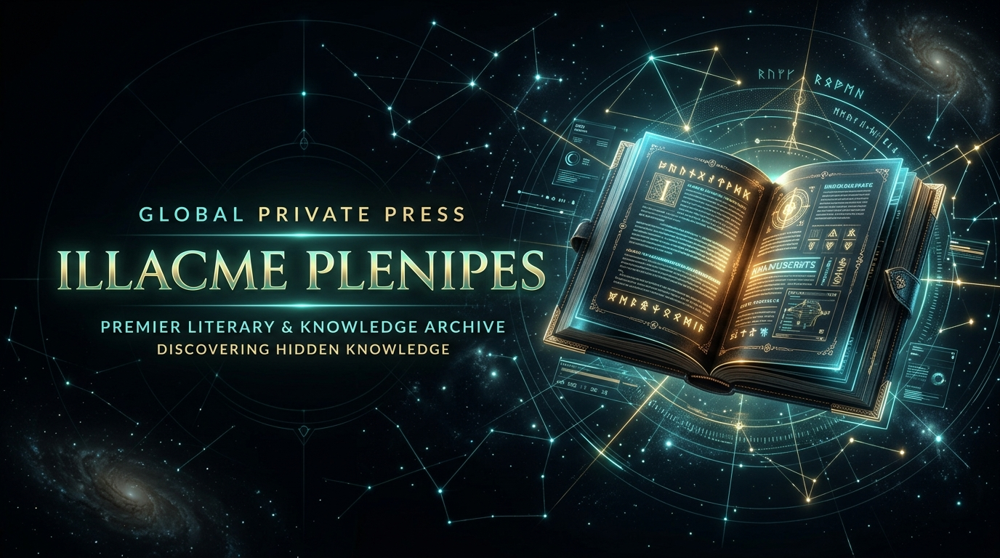
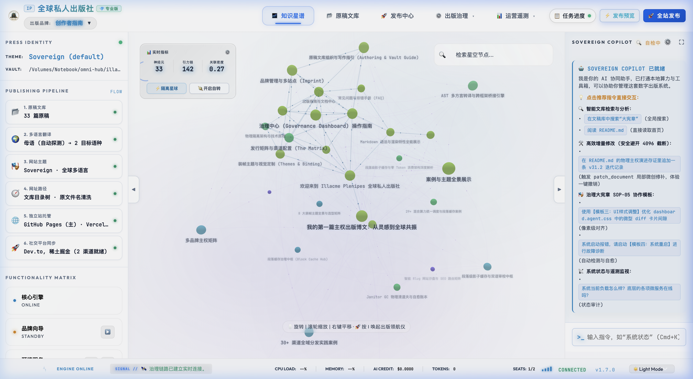
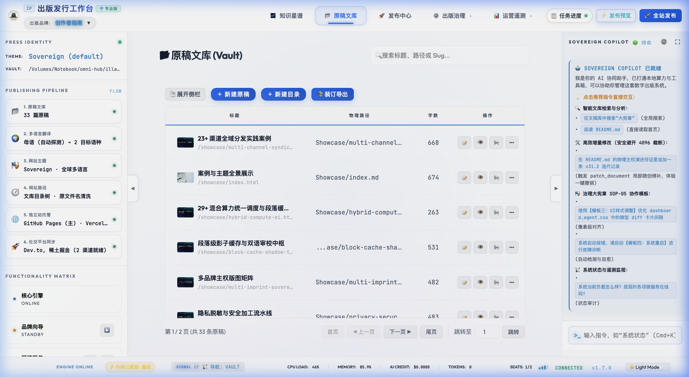
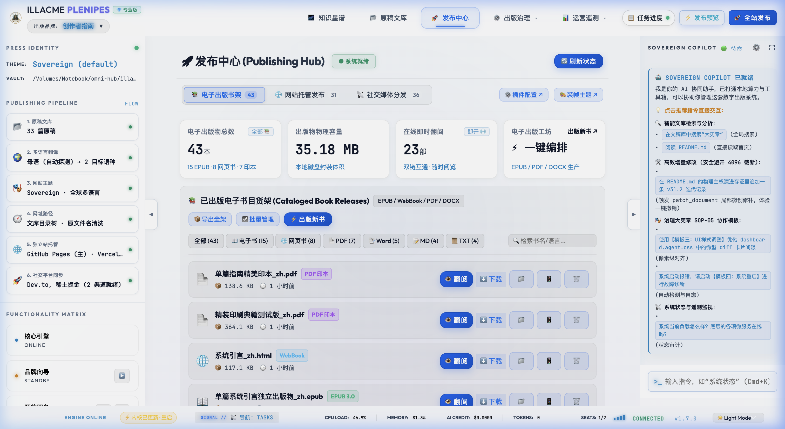
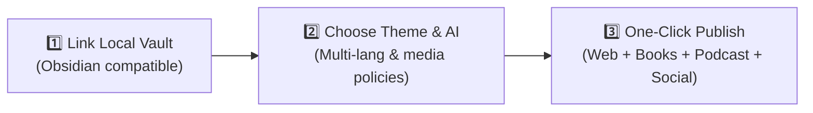

# 🏛️ Illacme Plenipes: Global Private Press

> **Local-first digital publishing workbench built for technical writers, indie developers, and solo global teams.**  
> Turn one local Markdown vault into a polyglot website, dual-host podcast (`RSS 2.0`), multi-format e-books (`EPUB / PDF / DOCX / WebBook`), and 30+ social syndication drafts—with 100% local data ownership and native MCP agent collaboration.



[](https://github.com/Illacme/illacme-plenipes)
[](https://github.com/Illacme/illacme-plenipes/releases/latest)
[](https://www.python.org/)
[](https://polyformproject.org/licenses/noncommercial/1.0.0/)

[🇨🇳 简体中文](./README.zh-CN.md) | [🇬🇧 English](./README.md) | [📖 Cookbooks](./docs/cookbook/) | [📚 User Manual](./docs/manual/) | [📝 v1.9.0 Release Notes](./docs/releases/v1.9.0.md)

---

### 💡 Creator Pain Points & How Illacme Plenipes Solves Them

| Daily Publishing Friction | How Illacme Plenipes Eliminates It |
| :--- | :--- |
| **1. Repetitive copy-pasting & broken image links across platforms** | Write once in Markdown and syndicate to 30+ platforms (WeChat, Xiaohongshu, Zhihu, Dev.to, Medium, Substack) with automatic formatting, footnote conversion, image re-hosting, and dead-letter retry diagnostics. |
| **2. Mismatched cover aspect ratios per channel** | Built-in **Cover Studio** with live safe-zone previews (`16:9` widescreen, `2.35:1` WeChat header, `3:4` Xiaohongshu portrait, `1:1` square) and multi-strategy generation (OG cards, brand presets, first-image extraction, AI generation). |
| **3. Wanting a companion podcast without recording/editing overhead** | Built-in **🎙️ Dual-Host Podcast Engine**: extracts dialogue scripts from articles, mixes TTS audio with smart-ducking BGM, generates chapter timestamps + standard RSS 2.0 (`Apple Podcasts / Spotify / Xiaoyuzhou`), and embeds players into sites & e-books. |
| **4. Multi-language drift & overwritten manual edits** | Maintain a single source-language vault while AI translates incrementally. Lock refined chapters via **Human Review Lock** so future rebuilds never overwrite your manual edits. |
| **5. Turning scattered notes into polished books** | Built-in **📚 Digital Bindery**: one-click export to **polyglot parallel WebBooks**, **EPUB 3**, **print-ready PDFs**, and **Word (.docx) with editable equations**, isolated per brand imprint. |
| **6. Platform lock-in & isolated AI workflows** | 100% local files (Obsidian compatible) with **Multi-Imprint isolation** and an open **MCP Server** (`Tools`, `Resources`, `Prompts`) so Cursor, Claude Desktop, or Antigravity can collaborate directly on your library. |

---

### ⚡ Quick Start: Zero-Config Desktop Client

> **No Python environment required.** Download the standalone client for your OS to launch the workbench (preloaded with the **Creator Guide (`default`)** sample imprint for instant hands-on exploration).

| Operating System | Recommended Format | Direct Download (`v1.9.0`) | Notes |
| :--- | :--- | :--- | :--- |
| 🍎 **macOS (Apple Silicon)** | **Native DMG Image (Preferred)** | [📥 **Illacme-Plenipes-macOS.dmg**](https://github.com/Illacme/illacme-plenipes/releases/latest/download/Illacme-Plenipes-macOS.dmg) | Drag to Applications; if Gatekeeper prompts, run bundled `双击修复无法打开.command` |
| 🍎 macOS (Apple Silicon) | Portable ZIP Archive | [📥 `Illacme-Plenipes-macOS.zip`](https://github.com/Illacme/illacme-plenipes/releases/latest/download/Illacme-Plenipes-macOS.zip) | Extract and run directly |
| 🪟 **Windows (x64)** | **Setup Wizard (Preferred)** | [📥 **Illacme-Plenipes-Windows-x64-Setup.exe**](https://github.com/Illacme/illacme-plenipes/releases/latest/download/Illacme-Plenipes-Windows-x64-Setup.exe) | Standard installer with desktop shortcuts |
| 🪟 Windows (x64) | Portable ZIP Archive | [📥 `Illacme-Plenipes-Windows-x64.zip`](https://github.com/Illacme/illacme-plenipes/releases/latest/download/Illacme-Plenipes-Windows-x64.zip) | Portable edition; double-click `Illacme-Plenipes.exe` |
| 🐧 **Linux (x64)** | Standalone Binary Archive | [📥 `Illacme-Plenipes-Linux-x64.tar.gz`](https://github.com/Illacme/illacme-plenipes/releases/latest/download/Illacme-Plenipes-Linux-x64.tar.gz) | Extract and run `./Illacme-Plenipes` (desktop & headless server) |

<details>
<summary><b>🛡️ First-Run OS Security Prompts? Unlock in 3 Seconds</b></summary>

Because this open-source client runs **100% locally with zero telemetry uploads** without commercial signing certificates:
* **🍎 macOS "Unverified developer" / "App is damaged"**: Double-click **`双击修复无法打开.command`** in the package, or **hold `Control` + right-click** `Illacme-Plenipes.app` in Applications $\rightarrow$ **Open**.
* **🪟 Windows Defender SmartScreen**: Click **"More info"** $\rightarrow$ **"Run anyway"**.

</details>

<details>
<summary><b>💻 Source Launchers & Keyboard Shortcuts (Developers / Docker)</b></summary>

* **macOS**: Double-click `start.command`; **Windows**: `start.bat` (or `.\start.ps1`); **Linux**: `./start.sh`; **Docker**: `docker compose up -d`.
* Workbench URL: `http://127.0.0.1:43212`
* **Shortcuts**: `I` (Publishing Navigator) · `Cmd/Ctrl+K` or `]` (Sovereign Copilot) · `Cmd/Ctrl+P` (Command Palette) · `[` (Toggle Left Sidebar).

</details>

---

### 🖥️ Inside the Publishing Workbench: 5 Sovereign Workspaces

#### 🌌 1. Knowledge Galaxy (`Overview`) & Publishing Navigator

* **Interactive 3D Knowledge Galaxy**: Parses Obsidian `[[wikilinks]]` and semantic entities into an interactive constellation; moving or renaming files automatically heals graph edges.
* **Publishing Navigator (`I`)**: Tracks the 6-stage pipeline (`Vault ➔ Translation ➔ Theme ➔ URL Routing ➔ Hosting ➔ Syndication`) with direct pills to your **Digital Bookshelf** and **Podcast Station**.

#### 📂 2. Manuscript Vault (`Vault`) & Single-Article Drawer

* **WYSIWYG & Markdown Dual Editor**: Full Obsidian/Logseq, LaTeX math, and local attachment support with atomic SQLite ledger and artifact synchronization on move/rename/delete.
* **Instant Single-Article Drawer**: Preview platform layouts, switch cover aspect ratios, synthesize podcasts, or publish a single article without rebuilding the entire site.

#### 🚀 3. Dispatch Hub (`Dispatch`): Hosting, Bindery, Podcast & Social Matrix

* **🌐 Free Static Site Hosting**: One-click deployment to GitHub Pages, Cloudflare Pages, Vercel, Netlify, and more with live URLs returned directly.
* **📚 Digital Bindery & Isolated Bookshelf**: Export **WebBooks**, **EPUB 3**, **print-ready PDFs**, and **DOCX with editable equations**, including polyglot parallel editions isolated per imprint (`dist/books/{imprint_id}`).
* **🎙️ Podcast Studio & RSS 2.0 Feed**: Synthesize dual-host episodes across 4 dialogue styles with **11-language adaptive voice selection** (with `🎧` ready badges), **Focus Guidance**, **custom host names & speech rate**, **incremental multi-language batch generation**, and **11 free open-source & commercial TTS engines** (`Edge TTS` zero-config default, `Kokoro`, `ChatTTS`, `CosyVoice`, `Piper`, plus `OpenAI`-compatible/SiliconFlow preset, `MiniMax`, `Volcengine`, `Gemini`, `ElevenLabs`, `Fish Audio` with inline voice testing & transparent fallback), generating chapter timelines, `podcast-feed.xml`, and R2/S3/OSS/COS CDN offloading.
* **🛰️ 30+ Social Channels & Self-Healing Ledger**: Track live results and retry or invoke Copilot diagnostics on dead-letter failures in one click.

#### ⚙️ 4. Governance (`Governance`) & 🎨 Cover Studio
* **Multi-Imprint Sovereignty**: Manage multiple independent publishing brands in one workbench with isolated vaults, themes, URL routing matrices, translation rules, and human review locks.

#### 🧠 5. Compute Hub (`Compute`) & 🤖 Editorial Chief Agent + Open MCP
* **25+ AI Models**: Connect OpenAI, Gemini, Claude, DeepSeek, or local models (Ollama / LM Studio) with block-level translation caching.
* **Sovereign Copilot**: Equipped with 14 autonomous publishing tools, persistent per-imprint multi-turn memory (`/clear` to reset), HITL confirmation, and pre-write snapshot rollback.
* **Standard MCP Server (`Tools` + `Resources` + `Prompts`)**: Click the **`🔌 MCP 协议`** badge in Copilot to copy client config for Cursor, Claude Desktop, or Antigravity.

---

### 🎯 3-Step Creator Workflow



<details>
<summary><b>📝 Minimal Markdown Sample (Obsidian & Companion Podcast Ready)</b></summary>

```markdown
---
title: "My First Sovereign Publication"
description: "Publish to web, podcast, e-book, and social channels from one Markdown file."
tags: ["Publishing", "Markdown"]
podcast: true   # Automatically synthesizes a dual-host MP3 episode during publish
cover: ""       # Leave blank for automatic Cover Studio generation
---

# Welcome to Sovereign Publishing

Use standard Markdown, LaTeX math ($$E = mc^2$$), and Obsidian wikilinks ([[architecture-overview]]).
```
</details>

---

### 💻 Developer CLI Mode

```bash
git clone https://github.com/Illacme/illacme-plenipes.git
cd illacme-plenipes
pip install -r requirements.txt

python3 plenipes.py                 # Start interactive console & Workbench UI (http://127.0.0.1:43212)
python3 plenipes.py --sync --force  # Run full multi-format build & sync pipeline
python3 plenipes.py --watch         # Watch vault for real-time incremental sync
```

---

### 📜 Licensing & Governance

* **Open Source Noncommercial**: [PolyForm Noncommercial 1.0.0](https://polyformproject.org/licenses/noncommercial/1.0.0/) for personal and academic use.
* **Commercial EULA**: Commercial or team usage requires written authorization; see [COMMERCIAL_LICENSE.md](./COMMERCIAL_LICENSE.md) and [EULA](./docs/legal/EULA.md) (`wqbyc@msn.com`).
* **Data Sovereignty & Disclaimers**: See [Data Sovereignty](./docs/legal/DATA_SOVEREIGNTY.md), [Third-Party Disclaimers](./docs/legal/THIRD_PARTY_DISCLAIMER.md), and [Third-Party Notices](./docs/legal/THIRD_PARTY_NOTICES.md).

---

*Powered by **Illacme Plenipes** | Sovereign Publishing for the Independent Mind.*
