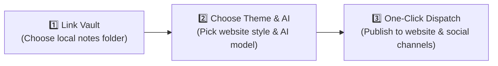

# 🏛️ Illacme Plenipes: Global Private Press

> **Industrial-grade digital publishing & distribution workbench built for sovereign creators.**  
> Native Markdown Vault ➔ Polyglot AI Translation ➔ Professional Typesetting ➔ Static Web Hosting & 30+ Social Media Syndication.


[](https://github.com/Illacme/illacme-plenipes)
[](https://github.com/Illacme/illacme-plenipes/releases/latest)
[](https://www.python.org/)
[](https://polyformproject.org/licenses/noncommercial/1.0.0/)

[🇨🇳 简体中文](./README.zh-CN.md) | [🇬🇧 English](./README.md) | [📖 Cookbooks](./docs/cookbook/) | [📚 User Manual](./docs/manual/)

---

### ⚡ Quick Start Desktop Client (Zero-Configuration)

> **No Python environment required. Packaged with native system tray, multi-language typesetting engine, and offline local publishing console.**

| Operating System | Recommended Format | Direct Download (Latest Stable) | Notes & First-Run Guide |
| :--- | :--- | :--- | :--- |
| 🍎 **macOS (Apple Silicon)** | **Native DMG Image (Preferred)** | [📥 **Illacme-Plenipes-macOS.dmg**](https://github.com/Illacme/illacme-plenipes/releases/latest/download/Illacme-Plenipes-macOS.dmg) | Drag to Applications. If prompted with damage warning, double-click bundled `双击修复无法打开.command` |
| 🍎 macOS (Apple Silicon) | Portable ZIP Archive | [📥 `Illacme-Plenipes-macOS.zip`](https://github.com/Illacme/illacme-plenipes/releases/latest/download/Illacme-Plenipes-macOS.zip) | Extract and run directly, includes bundled quarantine healer script |
| 🪟 **Windows (x64)** | **One-Click Setup Wizard (Preferred)** | [📥 **Illacme-Plenipes-Windows-x64-Setup.exe**](https://github.com/Illacme/illacme-plenipes/releases/latest/download/Illacme-Plenipes-Windows-x64-Setup.exe) | Standard installer with desktop shortcuts and uninstaller support |
| 🪟 Windows (x64) | Portable ZIP Archive | [📥 `Illacme-Plenipes-Windows-x64.zip`](https://github.com/Illacme/illacme-plenipes/releases/latest/download/Illacme-Plenipes-Windows-x64.zip) | Portable release; extract and double-click `Illacme-Plenipes.exe` |
| 🐧 **Linux (x64)** | Native Standalone Binary | [📥 `Illacme-Plenipes-Linux-x64.tar.gz`](https://github.com/Illacme/illacme-plenipes/releases/latest/download/Illacme-Plenipes-Linux-x64.tar.gz) | Extract and run `./Illacme-Plenipes`, headless server mode supported |

> 💡 **Release Notes & SHA256 Verification**: Visit the official **[GitHub Releases Hub](https://github.com/Illacme/illacme-plenipes/releases)** for complete changelogs and integrity signatures.

---

### 🖥️ Meet The Sovereign Publishing Workbench: Your Personal Publishing Studio

> **“Say goodbye to complicated terminal commands and scattered scripts. Here, publishing is an inspiring, visual creative journey.”**

Illacme Plenipes condenses the capabilities traditionally reserved for large publishing houses—translation, typesetting, formatting, and multi-channel distribution—into an elegant, easy-to-use **desktop publishing studio**.

#### 🌌 1. 3D Knowledge Galaxy & Visual Pipeline
How does a single draft reach readers around the globe? The workbench opens with an interactive **3D Dynamic Knowledge Galaxy** and a real-time **six-step publishing progress board**.


* **3D Knowledge Galaxy**: Your articles shine like stars in a personal constellation. Click any planetary node to explore article details and translations.
* **Six-Step Publishing Pipeline**: `Vault Origin ➔ Multi-Language Translation ➔ Website Style ➔ URL Paths ➔ Free Web Hosting ➔ Social Media Syndication`, with progress clearly visible at each step.
* **Caring AI Writing Companion**: Chat on the right sidebar anytime for library-wide knowledge search, chapter translation, or one-click polishing and proofreading.

---

#### 📂 2. Manuscript Vault & Instant Publishing Drawer
Designed for pure, distraction-free writing and peace of mind.


* **100% Local on Your Computer**: Connect directly to your local Obsidian or Markdown folder. No drafts are ever uploaded to cloud servers without your consent.
* **Clear Article Status**: Word counts, online web addresses, and multi-language translation status are visible at a single glance.
* **Instant Single-Article Drawer**: Want to push a fresh article to your personal site, Xiaohongshu, or WeChat without rebuilding the entire site? Click the drawer to publish instantly.

---

#### 🚀 3. Omni-Channel Dispatch Hub & Digital Bookshelf
Present your work to readers worldwide in multiple publication-grade formats.


* **📚 Digital Bookshelf**: One-click assembly of high-quality **Word documents (equations can be double-clicked to edit in Microsoft Word)**, **print-ready PDFs**, **universal EPUB eBooks**, and **web books**, ready for instant preview and download.
* **🌐 Free Personal Website Launch**: Deploy to GitHub Pages, Vercel, or Netlify with zero server costs. **Real online access links appear automatically upon completion.**
* **🛰️ 30+ Social Platforms at Once**: Instant one-click syndication to WeChat, Xiaohongshu, Zhihu, Juejin, Dev.to, Medium, and Substack, with automatic image re-hosting to prevent broken pictures.

---

### 💡 Why Choose Illacme Plenipes?

As an independent writer, overseas team, educator, or blogger, you often face these daily frustrations:
1. **Repetitive Formatting Work**: Pasting content platform by platform (WeChat, Medium, Dev.to, Substack) and fixing broken image links over and over again.
2. **Hard to Keep Multi-Language Versions in Sync**: Manually translating and maintaining separate files often leads to outdated or conflicting content.
3. **High Barriers to Personal Websites**: Want a beautiful personal documentation or blog site, but don't want to learn coding or server configuration.

**Illacme Plenipes** lets you focus entirely on creating:
* 🌍 **Write Locally, Share Globally**: Maintain just one Markdown file on your laptop (fully compatible with Obsidian / Logseq). AI handles natural paragraph translations.
* 🌐 **Free Personal Website in One Click**: Deploy to 10 top static hosting platforms (GitHub Pages, Vercel, Netlify, etc.) to showcase your multi-language library.
* 🛰️ **30+ Social Channels at Once**: Push to WeChat, Xiaohongshu, Medium, Dev.to, Substack, etc., with images automatically optimized and uploaded.
* 📚 **Publisher-Grade Book Export**: Automatically create bilingual **Word (.docx) files with editable formulas, print-ready PDFs, and EPUB eBooks** with clean multi-level tables of contents.
* 🛡️ **Absolute Privacy & Data Ownership**: Your drafts stay 100% on your local hard drive. Works completely offline with local AI models (like Ollama).

---

### 🚀 Quick Start (Zero Configuration)

#### 📦 1. Official Desktop Releases (Recommended)

Download the ready-to-run desktop clients from **[GitHub Releases](https://github.com/Illacme/illacme-plenipes/releases/latest)**:

| Operating System | Package Format | Download File | Recommended For |
| :--- | :--- | :--- | :--- |
| 🍎 **macOS (Apple Silicon)** | **Native DMG Image** | `Illacme-Plenipes-macOS-AppleSilicon-arm64.dmg` | **Top Choice**: Open and drag directly into "Applications" |
| 🍎 macOS (Apple Silicon) | Portable ZIP Archive | `Illacme-Plenipes-macOS-AppleSilicon-arm64.zip` | Extract and run without installation |
| 🪟 **Windows (x64)** | **Setup Installer (.exe)** | `Illacme-Plenipes-Windows-x64-Setup.exe` | **Top Choice**: Standard installer with desktop shortcuts |
| 🪟 Windows (x64) | Portable ZIP Archive | `Illacme-Plenipes-Windows-x64.zip` | Green portable edition, extract and run |
| 🐧 **Linux (x64)** | Standalone Archive | `Illacme-Plenipes-Linux-x64.tar.gz` | Linux desktops and cloud servers |

> [!IMPORTANT]
> ### 🛡️ First-Run Security Prompts? Unlock in 3 Seconds
> As an independent open-source client without expensive corporate certificates, macOS and Windows may show initial safety warnings. The app **runs 100% locally on your computer with zero privacy uploads**:
>
> * **🍎 macOS shows "App is damaged and can't be opened" or "Unverified developer"**:
>   * **Option A (One-click auto fix, recommended)**: Double-click the bundled **`双击修复无法打开.command`** script in the package. It removes the system quarantine automatically without requiring terminal commands.
>   * **Option B (Right-click bypass in Finder)**: In Finder -> Applications, **hold the `Control` key and right-click** `Illacme-Plenipes.app`, select **Open**, and click **Open** again in the confirmation prompt.
>
> * **🪟 Windows Defender shows blue alert "Windows protected your PC"**:
>   * Click the underlined text **"More info"**;
>   * Click the **"Run anyway"** button that appears in the lower-right corner.

---

#### 💻 2. Zero-Config Launchers (Source Mode)

If you cloned this repository, use our quick double-click launchers:

*   **🍎 macOS**: Double-click **`start.command`** in Finder (no terminal commands needed; browser opens automatically).
*   **🪟 Windows**: Double-click **`start.bat`** (or run `.\start.ps1` in PowerShell).
*   **🐧 Linux / Server**: Run `./start.sh`.
*   **🐳 Docker Compose**: Run `docker compose up -d`.

> 💡 **Dashboard Access**: Workbench UI runs at `http://127.0.0.1:43212`.

> ⌨️ **Convenient Shortcuts**:
> * `Cmd+P` (`Ctrl+P` on Windows/Linux): Open Command Palette & Guidebooks;
> * `Cmd+K` (`Ctrl+K` on Windows/Linux) or `]`: Summon AI Companion;
> * `I` (or click top-left Logo): Open Core Navigator;
> * `[`: Expand / collapse left sidebar.

<details>
<summary><b>📝 Click to expand: Minimal Markdown Sample (Obsidian Compatible)</b></summary>

```markdown
---
title: "My First Sovereign Publication"
description: "How to syndicate and publish globally using Illacme Plenipes."
tags: ["Publishing", "Markdown", "OpenSource"]
categories: ["Tech"]
draft: false
cover: "assets/covers/hero.png" # Optional, auto-generated by Design Studio
---

# Welcome to Sovereign Publishing

You can freely use standard Markdown, LaTeX math, and Obsidian wiki-links:
* Internal link: See [[architecture-overview]].
* Block math equation:
$$E = mc^2$$

The engine automatically cleanses syntax and renders native blocks cleanly on all target platforms!
```
</details>

---

### 🎯 3-Step Creator Journey



1. **Step 1: Link Notes Vault**: Select your local Markdown notes folder (like an Obsidian vault) in Settings. The app automatically builds your knowledge galaxy.
2. **Step 2: Choose Theme & AI Model**: Pick your favorite website presentation style (documentation, modern blog, knowledge base) and enter your AI API key (OpenAI, Gemini, DeepSeek, Claude, or local Ollama).
3. **Step 3: One-Click Dispatch**: Click "Deploy Website" or "Social Syndication" in the drawer to monitor progress and receive the live web address instantly.

---

### 🧩 Core Feature Matrix

| Hub Module | Capabilities | Practical Guide |
| :--- | :--- | :--- |
| **🌌 Knowledge Galaxy** | 3D interactive knowledge constellation, category filters, and publishing progress overview | [Galaxy Guide](./docs/manual/01_overview_galaxy.md) |
| **📂 Content Vault** | WYSIWYG & Markdown dual-mode editing, automatic tag organization, and local image asset management | [Vault Guide](./docs/manual/02_vault_management.md) |
| **📖 Bindery Bookshelf** | Bilingual parallel typesetting, Word with editable math equations / print-ready PDF / EPUB export, mobile QR preview | [Bindery Guide](./docs/manual/03_bindery_publishing.md) |
| **🚀 Dispatch Hub** | Visual publishing hall, complete deployment history, single-doc & whole-site publishing, live web URLs | [Dispatch Guide](./docs/manual/04_dispatch_and_hosting.md) |
| **⚙️ Publishing Governance** | Independent brand profiles, switchable website themes, translation rules, and human review workbench | [Governance Guide](./docs/manual/05_governance_and_review.md) |
| **🧠 AI Assistant** | Integrates with 25+ major AI models (ChatGPT, Claude, DeepSeek, local Ollama), helping with translation & proofreading | [Compute Guide](./docs/manual/06_compute_and_copilot.md) |
| **🎨 Design Studio** | AI cover generation, social media banner design, and automated book cover styling | [Design Guide](./docs/manual/07_design_studio.md) |
| **🧩 Channels & Plugins** | Supports 10 free website hosts + 20+ social media channels + image hosts, with clear connection status | [Plugins Guide](./docs/manual/08_plugins_ecosystem.md) |

---

### 💻 Developer CLI Mode

```bash
# 1. Clone & Setup
git clone https://github.com/Illacme/illacme-plenipes.git
cd illacme-plenipes
pip install -r requirements.txt

# 2. Interactive Console
python3 plenipes.py 

# 3. Full Pipeline Sync
python3 plenipes.py --sync --force

# 4. File Watcher Daemon
python3 plenipes.py --watch
```

---

### 📜 Licensing & Governance

*   **Open Source Noncommercial**: Licensed under [PolyForm Noncommercial 1.0.0](https://polyformproject.org/licenses/noncommercial/1.0.0/) for personal and research use.
*   **Commercial Licensing**: Commercial usage, corporate distribution, or multi-tenant deployment requires a written license. See [COMMERCIAL_LICENSE.md](./COMMERCIAL_LICENSE.md) and [EULA](./docs/legal/EULA.md) (Contact: `wqbyc@msn.com`).
*   **Data Sovereignty**: Zero remote data leakage. See [Data Sovereignty Agreement](./docs/legal/DATA_SOVEREIGNTY.md).
*   **Disclaimers**: See [Third-Party Disclaimers](./docs/legal/THIRD_PARTY_DISCLAIMER.md) and [Notices](./docs/legal/THIRD_PARTY_NOTICES.md).

---

*Powered by **Illacme Plenipes** | Sovereign Publishing for the Independent Mind.*