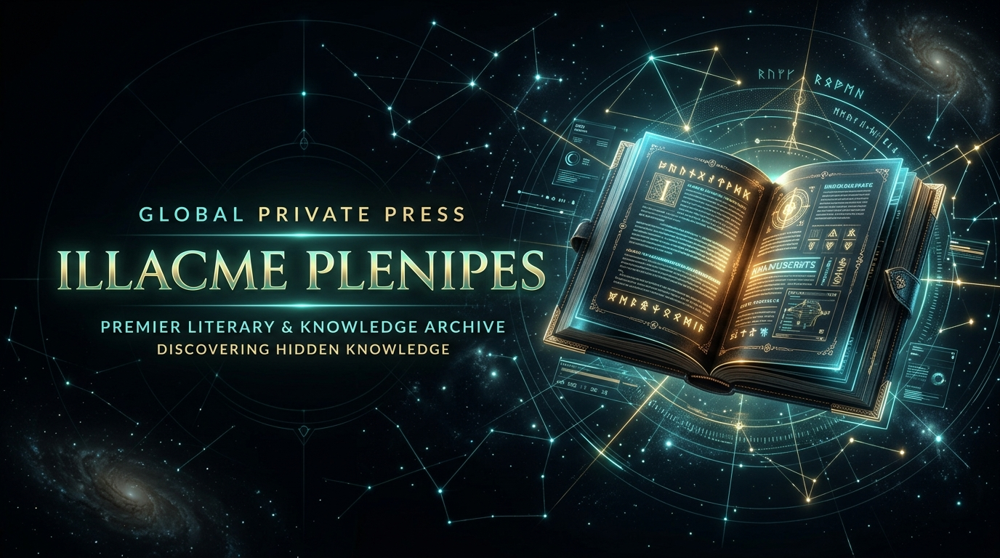
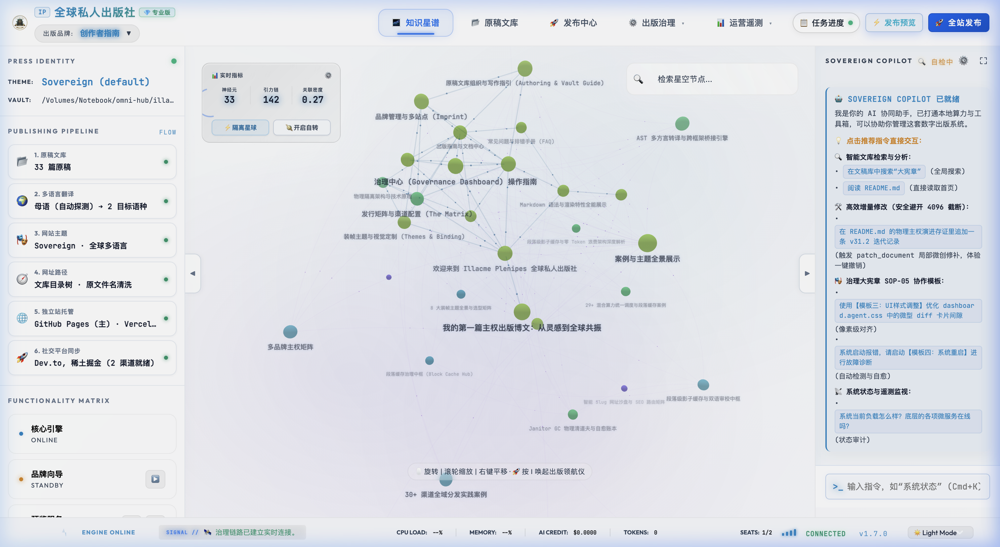
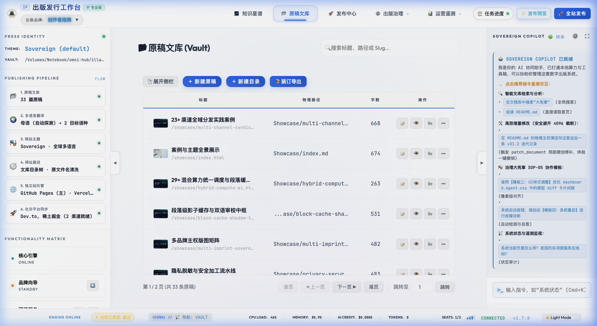
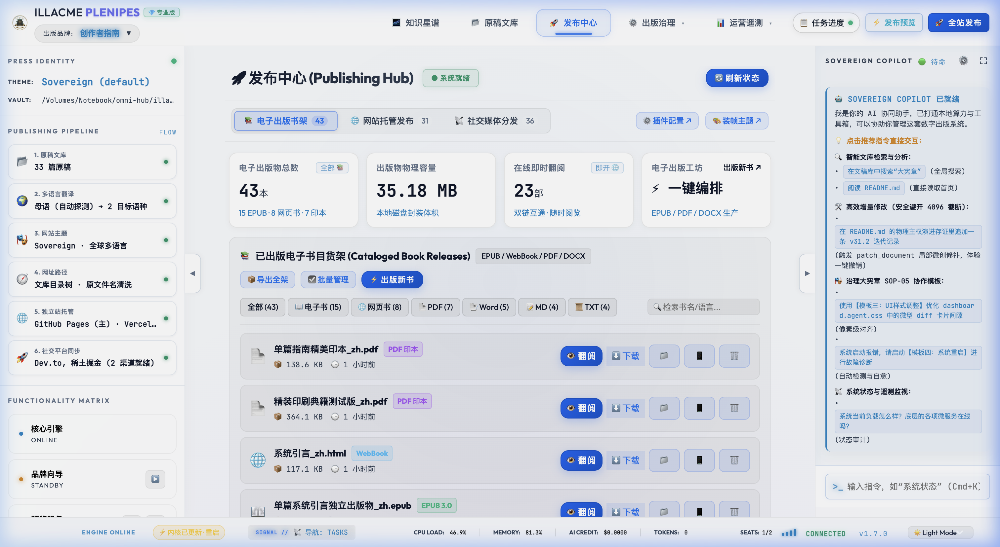

# 🏛️ Illacme Plenipes: 全球私人出版社 (Global Private Press)

> **面向技术作者、独立开发者与出海一人公司的本地优先数字出版工作台。**  
> 一份本地 Markdown 原稿 ➔ 1 分钟生成多语独立官网、双人伴读播客、多格式电子书（EPUB / PDF / DOCX / WebBook）与 30+ 社媒分发产物，数据 100% 留存本地，并开放 MCP 协议与 AI 主编协同。



[](https://github.com/Illacme/illacme-plenipes)
[](https://github.com/Illacme/illacme-plenipes/releases/latest)
[](https://www.python.org/)
[](https://polyformproject.org/licenses/noncommercial/1.0.0/)

[🇨🇳 简体中文](./README.zh-CN.md) | [🇬🇧 English](./README.md) | [📖 场景实战手册](./docs/cookbook/) | [📚 功能速查手册](./docs/manual/) | [📝 v1.9.0 发版说明](./docs/releases/v1.9.0.md)

---

### 💡 创作者痛点与破局方案：为什么选择 Illacme Plenipes？

作为独立作者、技术博主、学者或出海团队，日常内容生产常被“写作之外的杂活”拖垮：

| 常见创作与分发痛点 | Illacme Plenipes 的解决之道 |
| :--- | :--- |
| **1. 多平台重复搬运、图床防盗链破图** | 写完一篇文章，不再手动复制粘贴到公众号、小红书、知乎、Dev.to、Medium。工作台自动完成跨平台排版清洗、外链转脚注与图片自动转存，并支持死信队列重试与自愈诊断。 |
| **2. 封面画幅各异（横版 / 微信首图 / 小红书竖图）** | 内置 **Cover Studio 封面工坊**，支持按渠道自适应安全区裁切（`16:9`、`2.35:1` 微信首图、`3:4` 小红书竖图、`1:1` 方形），支持技术卡片、首图提取、品牌预设与 AI 生图。 |
| **3. 想做播客扩大传播，却没时间录音剪辑** | 内置 **🎙️ 双人伴读播客引擎**：从原稿一键提炼双人对谈剧本、合成带 BGM 自适应闪避混音的高清 MP3、生成章节时间轴与合规 RSS 2.0 订阅源（适配小宇宙 / Apple / Spotify），并自动嵌入网站与电子书。 |
| **4. 多语种版本难以同步，精修译文易被覆盖** | 只需维护一份本地母语 Markdown，AI 自动按段落增量翻译并支持**人工校对锁（Human Review Lock）**——手动精修锁定后，后续全站重译绝不覆盖您的心血。 |
| **5. 想把专栏沉淀成书，却受困于格式排版** | 内置 **📚 数字装订中枢**：一键合订导出**多语平行对照 WebBook**、**EPUB 3**、**带可双击编辑公式的 Word (.docx)** 与 **印刷级 PDF**，按出版品牌物理隔离书架。 |
| **6. 数据被云平台绑架、多专栏项目互相串台** | 文库 100% 留存本地硬盘（完美兼容 Obsidian 双链），支持**多出版品牌（Multi-Imprint）**独立运行；同时提供开放 **MCP 协议**，可让 Cursor / Claude Desktop / Antigravity 直接协助出版。 |

---

### ⚡ 快速开始：下载即用桌面客户端（零环境配置）

> **无需安装 Python 或任何开发工具。** 下载对应系统安装包即可启动本地出版发行工作台（首次启动内置演示品牌 **「创作者指南」** 供即开即用演练）。

| 操作系统 | 推荐格式 | 直接下载（最新稳定版 `v1.9.0`） | 安装与使用说明 |
| :--- | :--- | :--- | :--- |
| 🍎 **macOS (Apple Silicon)** | **原装 DMG 镜像（首选）** | [📥 **Illacme-Plenipes-macOS.dmg**](https://github.com/Illacme/illacme-plenipes/releases/latest/download/Illacme-Plenipes-macOS.dmg) | 拖入“应用程序”即可；首次若遇安全拦截，双击包内 `双击修复无法打开.command` |
| 🍎 macOS (Apple Silicon) | 便携 ZIP 压缩包 | [📥 `Illacme-Plenipes-macOS.zip`](https://github.com/Illacme/illacme-plenipes/releases/latest/download/Illacme-Plenipes-macOS.zip) | 免安装解压即用，内置一键放行脚本 |
| 🪟 **Windows (x64)** | **一键安装向导（首选）** | [📥 **Illacme-Plenipes-Windows-x64-Setup.exe**](https://github.com/Illacme/illacme-plenipes/releases/latest/download/Illacme-Plenipes-Windows-x64-Setup.exe) | 标准安装向导，自动创建桌面快捷方式 |
| 🪟 Windows (x64) | 便携 ZIP 压缩包 | [📥 `Illacme-Plenipes-Windows-x64.zip`](https://github.com/Illacme/illacme-plenipes/releases/latest/download/Illacme-Plenipes-Windows-x64.zip) | 绿色便携版，解压后双击 `Illacme-Plenipes.exe` |
| 🐧 **Linux (x64)** | 独立可执行归档 | [📥 `Illacme-Plenipes-Linux-x64.tar.gz`](https://github.com/Illacme/illacme-plenipes/releases/latest/download/Illacme-Plenipes-Linux-x64.tar.gz) | 解压后运行 `./Illacme-Plenipes`，支持桌面与无头服务器模式 |

<details>
<summary><b>🛡️ 首次运行遇到系统安全提示？3 秒无命令行放行方法</b></summary>

由于本软件为独立开源客户端，未购买高昂的商业签名证书，软件 **100% 运行在本地硬盘，无任何隐私上传**：
* **🍎 macOS 提示“无法打开”或“已损坏”**：
  * **方法 A（推荐）**：直接双击安装包内的 **`双击修复无法打开.command`**，自动解除隔离属性。
  * **方法 B**：在「访达 -> 应用程序」中**按住 `Control` 键右键点击** `Illacme-Plenipes.app` $\rightarrow$ 选择「打开」。
* **🪟 Windows Defender 蓝色提示** ：点击 **「更多信息」** $\rightarrow$ 点击右下角 **「仍要运行」**。

</details>

<details>
<summary><b>💻 源码双击启动与常用快捷键（开发者/Docker 用户）</b></summary>

* **macOS**：双击根目录 `start.command`；**Windows**：双击 `start.bat`（或 `.\start.ps1`）；**Linux**：`./start.sh`；**Docker**：`docker compose up -d`。
* 工作台控制台地址：`http://127.0.0.1:43212`
* **高频快捷键**：
  * `I`（或点击左上角 Logo）：呼出/关闭中央 **「出版领航仪」**（全景指标与 6 阶段直达）
  * `Cmd+K` / `Ctrl+K`（或 `]`）：唤起右侧 **Sovereign Copilot** 主编智能体
  * `Cmd+P` / `Ctrl+P`：打开命令面板与实战手册
  * `[`：展开 / 收起左侧导航栏

</details>

---

### 🖥️ 走进「出版发行工作台」五大主权功能区

#### 🌌 1. 知识星谱 (`Overview`) & 出版领航仪 (`Navigator`)

* **3D 动态知识星谱**：自动解析 Obsidian `[[双链]]` 与实体关联，将文库渲染为可交互的 3D 知识星图；移动或重命名原稿时自动同步图谱连线。
* **出版领航仪（快捷键 `I`）**：以六大出版阶段（`原稿文库 ➔ 多语言翻译 ➔ 装帧主题 ➔ 网址路径 ➔ 网站托管 ➔ 社媒分发`）直观展示全站进度与交付物直达入口（电子书架 / 播客电台）。

#### 📂 2. 原稿文库 (`Vault`) & 单篇出版抽屉

* **所见即所得与 Markdown 双模编辑**：无缝兼容 Obsidian / Logseq、LaTeX 公式与本地图片附件管理，文档改名/迁移/销毁原子级同步账本与静态产物。
* **单篇即时抽屉**：无需整站重编，单篇文章即可就地预览、更换多画幅封面、合成双人播客或推送至微信公众号、小红书等社媒平台。

#### 🚀 3. 发布中心 (`Dispatch`)：全站托管、电子书架、播客电台与社媒矩阵

* **🌐 个人独立站免费托管**：一键编译并部署至 GitHub Pages、Cloudflare Pages、Vercel、Netlify 等平台，完成后自动回传真实公网链接。
* **📚 数字装订与独立书架**：一键生成 **WebBook**、**EPUB 3**、**印刷级 PDF** 与 **可编辑公式 DOCX**，支持多语平行对照排版与品牌级书架隔离（`dist/books/{imprint_id}`）。
* **🎙️ 播客工坊与电台发行**：支持深度剖析 / 通俗快讯 / 观点交锋 / 单人伴读四种风格，支持 **11 语种双人神经声线自适应选择器**（含 `🎧` 已生成状态标示）、**🎯 聚焦引导**、**语速与主播人设自定义**与**增量批量联产**；内置 **11 种免费开源及商业级 TTS 引擎**（`Edge TTS` 免配即用，`Kokoro`、`ChatTTS`、`CosyVoice`、`Piper` 本地/自建开源，以及 `OpenAI`、`MiniMax`、`火山豆包语音`、`Gemini`、`ElevenLabs`、`Fish Audio` 与硅基流动预设，支持原地试听与自动降级提示），一键生成章节时间轴、合规 `podcast-feed.xml` 并转储至 R2 / S3 / OSS / COS CDN。
* **🛰️ 30+ 社媒矩阵与自愈账本**：支持微信公众号、小红书、知乎、掘金、Dev.to、Medium、Substack 等；分发失败时可一键重试或直接唤起 Copilot 诊断修复。

#### ⚙️ 4. 治理中心 (`Governance`) & 🎨 设计工坊
* **多品牌（Multi-Imprint）主权治理**：单工作台管理多个独立品牌，各自隔离文库路径、主题皮肤、网址路径矩阵（`route_matrix`）、多语翻译规则与人工校对工作台。
* **Cover Studio 与资产图库**：统一管理文章封面与品牌图库，支持跨平台安全区预览与一键应用。

#### 🧠 5. 算力中心 (`Compute`) & 🤖 主编智能体 + MCP 开放协议
* **25+ 模型算力调度**：自由接入 OpenAI、Gemini、Claude、DeepSeek 或本地离线模型（Ollama / LM Studio），支持段落缓存（Block Cache）大幅降低重复翻译成本。
* **Sovereign Copilot 主编智能体**：内置 14 项出版自治工具（星谱检索、选题成书、封面生成、播客合成、死信诊断与重试），支持按品牌持久化多轮对话、人类审批（HITL）与写前快照一键回滚。
* **标准 MCP Server（`Tools` + `Resources` + `Prompts`）**：点击 Copilot 面板 **`🔌 MCP 协议`** 徽章即可复制配置，让 Cursor、Claude Desktop 或 Antigravity 直接读取本地文库与知识星谱协同出版。

---

### 🎯 3 步开启您的全球私人出版社


<details>
<summary><b>📝 点击展开：兼容 Obsidian 与伴读播客的极简原稿示例</b></summary>

```markdown
---
title: "我的第一篇主权出版物"
description: "通过 Illacme Plenipes 实现多语站点、伴读播客与电子书一体化发行。"
tags: ["Publishing", "Markdown"]
podcast: true   # 开启后全站发布或播客工坊将自动衍生双人对谈音频
cover: ""       # 可留空，由 Cover Studio 自动生成或从资产库绑定
---

# 欢迎来到主权出版时代

支持标准 Markdown、LaTeX 数学公式（$$E = mc^2$$）与 Obsidian 双链（[[architecture-overview]]）。
```
</details>

---

### 💻 开发者命令行模式 (CLI)

```bash
git clone https://github.com/Illacme/illacme-plenipes.git
cd illacme-plenipes
pip install -r requirements.txt

python3 plenipes.py                 # 启动交互式控制台与 Web 工作台 (http://127.0.0.1:43212)
python3 plenipes.py --sync --force  # 命令行执行全量同步与多媒介构建
python3 plenipes.py --watch         # 开启文库变更毫秒级守护监听
```

---

### 📜 治理协议与商业许可 (Licensing & Governance)

* **开源非商业许可**：采用 [PolyForm Noncommercial 1.0.0](https://polyformproject.org/licenses/noncommercial/1.0.0/) 协议，个人创作与学术研究免费使用。
* **商业授权 (Commercial EULA)**：商业运营、团队协同或企业部署须取得书面授权，详见 **[商业授权说明](./COMMERCIAL_LICENSE.md)** 与 **[EULA](./docs/legal/EULA.md)**（商务联系：`wqbyc@msn.com`）。
* **数据主权与免责**：详见 **[数据主权协议](./docs/legal/DATA_SOVEREIGNTY.md)**、**[第三方凭据免责声明](./docs/legal/THIRD_PARTY_DISCLAIMER.md)** 与 **[第三方开源致谢](./docs/legal/THIRD_PARTY_NOTICES.md)**。

---

*Powered by **Illacme Plenipes** | 让主权照耀创作，让品牌横跨全球。*
